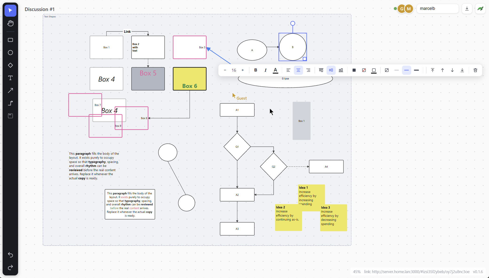

# turtle-sketch

Collaborative whiteboard in the browser. No accounts, no authentication or authorization. Just share the link, give it any name. 
Vector shapes on an infinite canvas, arrow/line connectors that attach to shapes and stuff. Dockerized and ready to go.



## Attention
This is meant be used privately. Install *only* on safe private networks, since everyone who has access to the host can delete and change all data and whiteboards. I gave literally no thought on making this internet secure. There are probably hilariously simple ways to abuse the server implementation.

Largely vibe-coded, not all code is human reviewed, some unexpected quirky behaviour expected, best effort approach, MIT License, provided "as is", no warranty of any kind.

## Run with Docker

```sh
docker compose up --build
# open http://localhost:3000
```

State is persisted as compacted Yjs snapshots in the data folder: boards live at `/data/<workspace>/<board>.bin`,
with a rolling window of up to 25 timestamped backups per board in `/data/backups/<workspace>/`.

## Run locally (development)

```sh
npm install
npm run build        # build client once, or use dev mode:
npm run dev:server   # API + WS on :3000 (serves client/dist)
npm run dev:client   # Vite dev server with /ws proxy
```

## Controls

- Left sidebar tools: Select `V`, Hand/pan `H`, Rect `R`, Ellipse `E`, Text `T`, Arrow `A`, Frame `F`
- Pan: hand tool or middle-mouse drag; mouse wheel: zoom at cursor
- Top right: connected users (avatars) + your name; bottom right: zoom + room link + app version (from package.json, also shown bottom-right on the dashboard)
- Selecting a shape shows a floating bar: font size, bold, left/center/right, top/middle/bottom, delete
- Drag: create shape / marquee-select; drag shape: move (frames carry their contents)
- Arrows: drag from a shape (docks) or empty canvas (free end) to another shape or empty space; with select, drag the endpoint dots to re-dock/undock freely, drag the middle dot to curve the line; selecting an arrow shows dash / thin-medium-thick / arrowhead options
- Drag the corner handle: resize; `Shift`-click: multi-select; `Delete`: remove (connectors too)
- With 2+ objects selected, the floating bar offers space-evenly-horizontal/vertical (gap of the two leftmost/topmost applied to all, minimum 10px edge-to-edge) and align top/bottom (to the highest/lowest edge); groups expand to their members, connectors and frames are excluded
- Double-click a shape: edit its text inline (or the frame's name); double-click an arrow: edit its rich-text label at its midpoint (multiline, size/bold/italic/color via the floating bar; the input grows with the content); `Ctrl+Enter` commits, `Esc` reverts; the floating bar sets left/center/right and top/middle/bottom alignment
- `Ctrl+Z` / `Ctrl+Shift+Z`: undo/redo (local edits only, last 30 steps)
